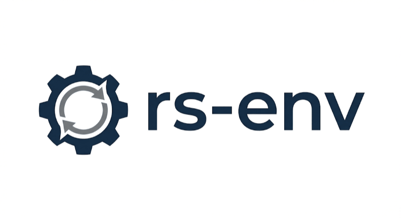

[](https://opensource.org/licenses/BSD-3-Clause)

# rsenv: your private workspace for every project

[Crate of the week 512](https://this-week-in-rust.org/blog/2023/09/13/this-week-in-rust-512)

Some things belong to a project but must never be committed with it: env vars, secrets, your
patched `docker-compose.yml`, personal notes. rsenv keeps them in a **vault** outside the repo,
versioned and encrypted, and links it to the project with a single symlink.


`rsenv vault init` creates the vault and turns `.envrc` into a symlink to it. That symlink is
the only trace in your repo; [direnv](https://direnv.net) loads it and exports `RSENV_VAULT`.

## What you get

| Need | rsenv | Command |
|---|---|---|
| Env vars without copy-paste | **Env hierarchy**: `prod.env` inherits from `cloud.env` inherits from `base.env` | `rsenv env build prod.env` |
| Secrets the project needs on disk | **Guard**: the file moves into the vault, a symlink stays | `rsenv guard add .env` |
| Local versions of committed files | **Swap**: put your variant in, the original back out | `rsenv swap in config.yml` |
| Safe backup and sharing | **SOPS encryption** plus a git repo for all vaults | `rsenv vault commit` |
| `git worktree` for parallel work | **Worktrees** borrow main's vault files | `rsenv worktree attach DIR` |

### Env hierarchy

A `# rsenv: parent.env` line makes an env file inherit its parent; the child wins.


`rsenv env envrc $RSENV_VAULT/envs/prod.env` writes the merged result into `.envrc`.

### Guard


Git sees a symlink, never the secret.

### Swap


`swap in` puts your vault variant in place and parks the original; `swap out` saves your edits
back to the vault and restores the original, so `git status` stays clean. `swap diff` shows what
you changed meanwhile.

### Encrypt and back up

Vault files are SOPS-encrypted (GPG or Age); the plaintext's hash in the file name tells rsenv
which ciphertexts are stale, without needing your key:


All vaults live in one git repo (`~/.rsenv`):

```bash
rsenv swap out              # the vault must hold your latest edits
rsenv vault commit -a       # encrypt, then commit this project's vault
```

### Git worktrees

A linked worktree uses main's vault instead of getting its own: `rsenv worktree attach` links
its `.envrc` and borrowed files to main. Commands that would corrupt the vault refuse to run
in a worktree.

## Quick start

```bash
brew tap sysid/rsenv && brew install rsenv      # or: cargo install rsenv

cd myproject
rsenv vault init                                # vault + .envrc symlink
direnv allow                                    # now $RSENV_VAULT is set
rsenv env envrc $RSENV_VAULT/envs/local.env     # write the local env into .envrc
direnv allow                                    # load it
rsenv guard add .env                            # move a secret into the vault
rsenv info                                      # what rsenv manages here
```

## Documentation

[Getting Started](https://github.com/sysid/rs-env/wiki/Getting-Started) ·
[Concepts](https://github.com/sysid/rs-env/wiki/Core-Concepts) ·
[Commands](https://github.com/sysid/rs-env/wiki/Command-Reference) ·
[all pages](https://github.com/sysid/rs-env/wiki)

`rsenv --help` and `rsenv <command> --help` are the complete reference.

## License

BSD-3-Clause
