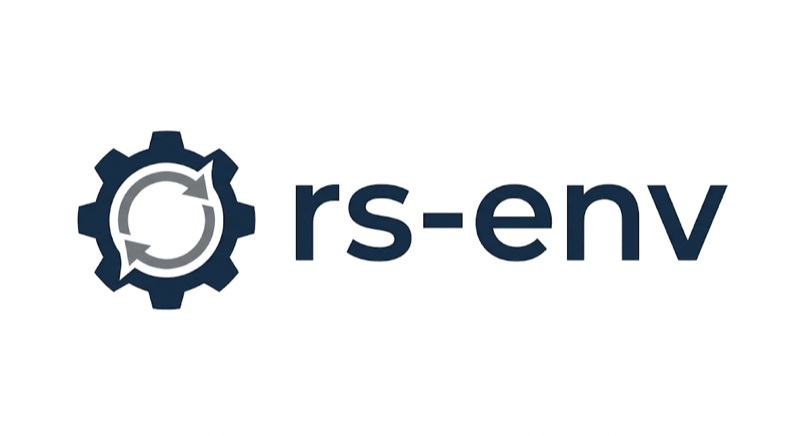

[](https://opensource.org/licenses/BSD-3-Clause)

# Zero-Trace Secure Developer Environments

[Crate of the week 512](https://this-week-in-rust.org/blog/2023/09/13/this-week-in-rust-512)

## Why?

- Working on several projects, with different teams, many repos is my reality.
- I need a personal workspace, which is attached to the project, but does not become part of its
  official repository (e.g. patched docker-compose.yml, bespoke Java test classes, etc.)
- My environment configurations are not DRY, they share variables, often follow even a hierarchy
  (global -> company -> region -> stage)


---

## 1. The Vault

The vault is a directory **outside the project** that holds a personal
workspace: env files, secrets, dev overrides. 

It is linked to the project via a single `.envrc` symlink — **the only trace of rsenv in your repo**.


**How it connects**: `rsenv vault init` creates the vault, moves the `.envrc`
there (as `dot.envrc`), and creates the symlink.

---

## 2. File Swapping

Swap temporarily replaces project files with your dev versions.
Unlike guard, this is reversible — swap in when you start work, swap out when done.


**Hostname tracking**: The sentinel `<file>@@<hostname>@@rsenv_active` records which
machine swapped the file in, preventing conflicts when sharing vaults. It also holds a copy
of the vault content as of swap-in, which is the baseline `rsenv swap diff` compares against.

**Key commands**:
- `rsenv swap init <files>` — set up files for swapping (first time)
- `rsenv swap in` — replace project files with vault versions
- `rsenv swap out` — restore originals (no args = all files)
- `rsenv swap status` — show what's swapped in, by which host
- `rsenv swap status --silent` — exit code only: 0=clean, 1=dirty, 2=unmanaged
- `rsenv swap diff` — show what changed in swapped-in files since swap-in, as a patch
- `rsenv swap diff --stat` — same, summary only (no patch)
- `rsenv swap delete <files>` — remove entries from the vault; the project returns to its swapped-out state (asks first, `-y` skips)
- `rsenv vault commit` — commit this project's vault data (requires it to be swapped out)
- `rsenv vault commit -a` — same, with a generated commit message

**Checkpointing your work into the vault**: while content is swapped in, the live bytes are
in the project and the vault holds only a frozen sentinel — so that work is in *no* git repo
until you swap out. `rsenv swap out` closes that window; `rsenv vault commit` then records it
in one commit scoped to this project's vault directory alone, never sweeping in other
projects. It refuses while anything is still swapped in, so it can never commit a sentinel in
place of your work.

```bash
$ rsenv swap out
$ rsenv vault commit -a
✓ Committed b4247db to vault (2 files)
  M swap/thoughts/notes.md
  A swap/thoughts/research/2026-09-13-ranking.md
Linked to: a3bddf6 (main)
```

The message records the **project's** HEAD commit — the link between a state in the vault and
the project state it belongs to:

```
vault(myproject): checkpoint @ a3bddf6

project:        /home/you/dev/myproject
project-commit: a3bddf6028e11155c9f2bd66776d395a99a3ef83 (main)

 M swap/thoughts/notes.md
```

`vault commit` never swaps anything itself — swapping stays your explicit action, which is
also what refreshes `RSENV_SWAPPED`: a swap cannot write a running shell's environment
(a child process cannot change its parent's), so instead it bumps the mtime of the vault's
`dot.envrc`. direnv watches that file through the `.envrc` symlink and re-evaluates at the
next prompt — in every shell sitting in the project, including the ones `rsenv swap out -g`
never visited. The file's bytes are untouched, so the content hash, the SOPS ciphertext and
`direnv allow` are all unaffected.

**Seeing your changes while swapped in**: while a file is swapped in, its content lives in
the project and the vault holds only the sentinel, so neither `git diff` shows anything.
`rsenv swap diff` closes that gap without leaving the project directory:

```bash
$ rsenv swap diff --stat
thoughts:
  M docs/SEARCH.md
  A research/2026-09-13-ranking.md
```

Like `git diff`, the patch is the default view and is piped through your configured pager —
`swap diff` asks git for it (`git var GIT_PAGER`), so a `core.pager = delta` setup renders
these diffs exactly as it renders git's. Paging is skipped when output is not a terminal,
keeping pipes and scripts plain. Patch headers are project-relative, so a viewer can open
the file they point at.

Dot-file names are reported as they appear in the project (`.gitignore`), not in their
neutralized vault form (`dot.gitignore`).

---

## 3. Environment Hierarchy

Env files form a tree using the `# rsenv: parent.env` directive.
Children inherit all parent variables and can override them.


**Build result** — `rsenv env build prod.env` merges the chain:


**Quoting** — rsenv preserves the source's quote style, matching shell semantics:

```
  export PW='p@$$w0rd'      ◄ single quotes → emitted literal (no expansion)
  export DIR="$HOME/bin"    ◄ double quotes → $HOME expands when sourced
```

Store secrets that contain `$`, backticks, or other shell metacharacters in
**single quotes** so they survive sourcing verbatim.

**Key commands**:
- `rsenv env tree` — visualize the hierarchy
- `rsenv env select` — fuzzy-pick an env, write to `.envrc`
- `rsenv env build <file>` — merge and output variables
- `rsenv env envrc <file>` — update the vars section of `dot.envrc`
- `rsenv env init` — recreate the default env files (existing ones swept to `<name>.bkp.<ext>`)

---

## 4. File Guarding

Guard permanently moves sensitive files to the vault and leaves a symlink behind.
Git sees the symlink, not the secret.


**Dotfile neutralization**: Dotfiles are renamed in the vault to prevent
side effects: `.gitignore` → `dot.gitignore`, `.envrc` → `dot.envrc`.

**Key commands**:
- `rsenv guard add <file>` — move to vault, create symlink
- `rsenv guard list` — show all guarded files
- `rsenv guard restore <file>` — move back to project
- `rsenv guard delete <file>` — delete for good: vault copy, ciphertexts and project link (asks first, `-y` skips)

---

## 5. SOPS Encryption

Vault contents can be encrypted at rest using SOPS (with GPG or Age).
rsenv uses content-addressed filenames to detect staleness.


**Status categories**:

| Status | Meaning | Action |
|--------|---------|--------|
| `current` | Hash matches, up-to-date | None |
| `stale` | Plaintext changed since encrypt | Re-encrypt |
| `pending_encrypt` | No encrypted version exists | Encrypt |
| `orphaned` | `.enc` exists but plaintext gone | Can delete |

A pre-commit hook (`rsenv hook install`) blocks commits when files are
stale or unencrypted. `rsenv sops gitignore-sync` keeps plaintext out of git.

Without a vault: every sops command takes `--dir PATH`, so rsenv also manages a plain
directory such as a secrets repo. Such a directory takes its patterns from the global
config only ([details](https://github.com/sysid/rs-env/wiki/SOPS-Encryption#encrypting-a-plain-directory-no-vault)).

---

## Putting It All Together


**Defense in depth**:

| Layer | Protection |
|-------|------------|
| Vault location | secrets live outside the project directory and its git |
| Symlinks | git commits harmless symlinks, not secrets |
| SOPS encryption | vault contents encrypted at rest |
| `.gitignore` sync | plaintext ignored by git automatically |

[See all features in the wiki](https://github.com/sysid/rs-env/wiki)

## Quick Start

```bash
# macOS (Homebrew)
brew tap sysid/rsenv
brew install rsenv

# Or via Cargo
cargo install rsenv

rsenv vault init            # Create vault for project
rsenv guard add .env        # Move .env to vault, create symlink
rsenv env tree              # View environment hierarchy
rsenv env select            # Interactive environment selection
```

[Full quick start guide](https://github.com/sysid/rs-env/wiki/Quick-Start)

[Full command reference](https://github.com/sysid/rs-env/wiki/Command-Reference)

## Documentation

**Getting Started**: [Installation](https://github.com/sysid/rs-env/wiki/Installation) · [Quick Start](https://github.com/sysid/rs-env/wiki/Quick-Start) · [Core Concepts](https://github.com/sysid/rs-env/wiki/Core-Concepts)

**Features**: [Environment Variables](https://github.com/sysid/rs-env/wiki/Environment-Variables) · [Vault Management](https://github.com/sysid/rs-env/wiki/Vault-Management) · [File Swapping](https://github.com/sysid/rs-env/wiki/File-Swapping) · [SOPS Encryption](https://github.com/sysid/rs-env/wiki/SOPS-Encryption) · [Backup and Recovery](https://github.com/sysid/rs-env/wiki/Backup-and-Recovery)

**Reference**: [Commands](https://github.com/sysid/rs-env/wiki/Command-Reference) · [Configuration](https://github.com/sysid/rs-env/wiki/Configuration) · [Troubleshooting](https://github.com/sysid/rs-env/wiki/Troubleshooting) · [Migration Guide](https://github.com/sysid/rs-env/wiki/MIGRATION)

## License

BSD-3-Clause
